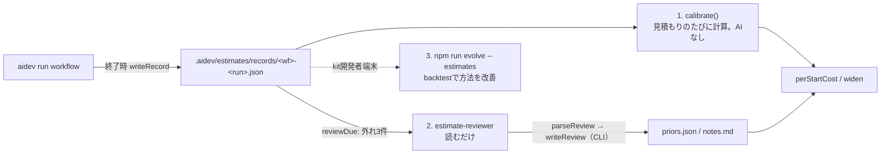

# Architecture and internal behavior

この文書はai-dev-kit（PKG clone方式）の技術設計を、本体を保守する人向けに説明します。利用者向けの手順は`docs/user-guide/`を参照してください。

## 1. PKG clone方式

`aidev`は利用者自身のPKG git cloneの中で動きます。wrapper repositoryもsubmoduleもありません。kitがPKGへ追加するものはすべてそのPKG repositoryへcommitされ、チーム全員がgitで同じ設定・同じWikiを受け取ります。

```text
<pkg clone>/
├─ aidev.yaml                     PKG固有設定（schema v2）
├─ CLAUDE.md                      templates/claude から適用（kit配布、teamが編集可）
├─ .mcp.json                      PKG の所有（kit は配布しない。MCP server は PKG が用意する）
├─ .claude/                       templates/claude/.claude から適用（同上）
│  ├─ settings.json               hooks / deny / ask
│  ├─ agents/  skills/
│  └─ settings.local.json         個人設定。kit所有ではなくdrift検出から除外
├─ .github/  AGENTS.md  .codex/  .kiro/   tools.default に copilot / codex / kiro があるときだけ（§2）
└─ .aidev/
   ├─ .gitignore                  CLIが書く。runtime stateをgitから外す
   ├─ policy.yaml                 承認済みpolicy（CLIだけが配置）
   ├─ policy.candidate.yaml       承認待ちの候補（一時）
   ├─ materialized.json           適用したtemplateとfileのhash record、未解消conflict（applyのmerge基準）
   ├─ ejected.json                aidev uninstall --package の marker（通常は存在しない）
   ├─ knowledge/                  LLM Wiki（manifest.json, inventory/, index.md, overview.md, pages）
   │  └─ .cache/                  plan.json（hook経路のbatch計画）、agent task、完了報告 done/（ignored）
   ├─ conventions/                開発規約（PKG の workflow が生成し、team が review して commit）
   ├─ estimates/                  見積もりの学習（commit して team で共有）: records/<wf>-<run>.json、priors.json、notes.md、judgments/<wf>.json
   ├─ workflows/<name>/           workflow.yaml（runs/<id>/ は実行記録でignored）。承認 = origin/<tracking_branch> と同一
   ├─ agents/<name>.md            PKG固有のagent定義（workflowが名前で参照。kit同梱より優先）
   ├─ skills/<name>/SKILL.md      PKG固有のskill（同上）
   ├─ sync.lock                   publish lease（ignored）
   └─ cache/                      remote-check.json, last-head.json, wiki-stop.json, wiki-worktree/,
                                  agents/（prompt file）, evolution/<session>.md（kit開発者端末の振り返り）（ignored）
```

`.aidev/.gitignore`の内容は`layout.AIDEV_GITIGNORE`で固定です（`cache/`、`sync.lock`、`knowledge/.cache/`、`workflows/*/runs/`）。`init`、`apply`、`sync wiki`（worktree内でも）が`ensureAidevGitignore`で書き、内容が違えば上書きします。

path名の正本は`cli/lib/layout.js`です。`KIT_MANAGED_GLOBS`（`aidev.yaml`、`.aidev/**`、全toolの`TOOL_CONFIG_GLOBS`: `.claude/**`、`CLAUDE.md`、`.mcp.json`、`.github/copilot-instructions.md`、`.github/agents/**`、`.github/skills/**`、`.github/hooks/**`、`AGENTS.md`、`.codex/**`、`.kiro/steering/**`、`.kiro/agents/**`）に一致するpathはWikiのgeneration targetにもevidenceにもならず、PostToolUseのquality gateも走りません。`git.findRepoRoot`は`aidev.yaml`または`.aidev/`を持つdirectoryまで上へ辿り、無ければgit top-levelへfallbackします。

### 端末側: kit checkoutと`AIDEV_HOME`

| 場所 | 役割 |
| --- | --- |
| kit checkout（`installRoot`） | ai-dev-kit自身のclone。launcherが`cli/bin/aidev.js`を指す。`aidev update`が`origin/main`へfast-forwardする。templateの読み出し元 |
| launcher | `scripts/install.ps1`が`%LOCALAPPDATA%\ai-dev-kit\bin\aidev.cmd` / `.ps1`、`scripts/install.sh`が`~/.local/bin/aidev`を作る（`AIDEV_BIN_DIR`で変更可） |
| `AIDEV_HOME` | 既定はWindows `%LOCALAPPDATA%\ai-dev-kit`、POSIX `$XDG_DATA_HOME/ai-dev-kit`（未設定なら`~/.local/share/ai-dev-kit`）。`registry.json`、`cache/update-check.json`、kit開発者端末では`developer.json`と`cache/evolve/`（§13）を置く |

`registry.json`（`{schemaVersion: 1, packages: [{name, path, remote, kitCommit, registeredAt, updatedAt?}]}`）は`init`と`apply`が登録し、`eject`が削除します。`uninstall`は`registry.json`と`cache/`ごと消します（PKG側には触れず、kit所有fileを消す`git rm`を表示するだけ）。`update`はここに載っているcloneのうちlockの`kitCommit`が現在のkitと違うものを「`aidev sync tools`が必要」として一覧します（適用はしません）。

## 2. tool configのtemplate、apply、記録

### template → PKG

toolごとに`templates/<tool>/`があり、PKG rootにそのまま重なるtreeです（`tools.templateDir(id)`）。対応表はありません。

| tool | template tree（PKGでの位置と同じ） |
| --- | --- |
| `claude` | `templates/claude/.claude/**`、`templates/claude/CLAUDE.md` |
| `copilot` | `templates/copilot/.github/copilot-instructions.md`、`.github/agents/<agent>.agent.md`、`.github/skills/<skill>/**`、`.github/hooks/aidev.json` |
| `codex` | `templates/codex/AGENTS.md`、`.codex/hooks.json` |
| `kiro` | `templates/kiro/.kiro/steering/ai-dev-kit.md`、`.kiro/agents/<agent>.json`、`.kiro/agents/aidev.json`（hooksを持つ主担当agent） |

treeはkit保守者が手で揃えます（toolごとの差はtemplateから生成できないため）。claude以外のtreeは実機未検証で、fileの先頭にその旨を書いています。`layout.TOOL_CONFIG_GLOBS`がkit所有pathの正本で、`isKitManaged` / `ALWAYS_PROTECTED` / `settings.json`のdeny listはこれに従います。`.claude/settings.local.json`は個人設定で常に除外です（`STATIC_EXCLUDE`）。

### apply（`assets.applyTemplates`）

`aidev init`（初回、lockが無いとき、または`--force`）と`aidev sync tools`が呼びます。`aidev update`はkit checkoutを進めるだけでPKGには触れません。適用はcopyではなくmergeです。file単位の判定:

| 状態 | 結果 |
| --- | --- |
| 無い | `created` |
| templateと同一 | `unchanged` |
| 前回適用したtemplateのまま（`pristine`: hashがlockの`kit`と一致） | `updated`（新templateで置換） |
| 編集済み、kitは不変（lockの`kit`が新templateのhashと一致） | `kept`（そのまま。lockの`file`を更新） |
| 編集済み、kitも変更 | 3-way merge。base = lockの`kitCommit`にあったtemplate（kit checkoutの`git show <sha>:templates/<tool>/<rel>`）。cleanなら`merged`、同一箇所ならgit merge-fileのmarker付きで書き`conflicts`、baseが履歴に無ければ触らず`conflicts` |
| lockに無く、templateと違う（初回に既存fileがある） | 触らず`conflicts`（`--force`でkit版） |
| 前回のconflict、markerが残っている | 触らず`conflicts` |
| 前回のconflict、markerが消えた | `resolved`（現在の内容を記録） |
| templateから消えた（kitが配布をやめた、toolが`tools.default`から外れた） | pristineなら`pruned`、編集済みなら`retired`（残してlockから外す） |

`--force`は全fileをkit版にします。`--dry-run`はfileもlockも書きません。空になったtool directoryは`pruneToolDirs`が消します（`.claude/`自体は残す）。

### `.aidev/materialized.json`（schemaVersion 4）

```json
{
  "schemaVersion": 4,
  "kitCommit": "<kit checkoutのHEAD>",
  "kitVersion": "0.4.0",
  "tools": ["claude", "copilot"],
  "appliedAt": "...",
  "files": { "<rel>": { "kit": "sha256:<適用したtemplate>", "file": "sha256:<書いた/受け入れた内容>" } },
  "conflicts": ["<rel>", "..."]
}
```

schema 3以前の`files: { rel: "sha256:…" }`は`kit: null, file: <hash>`として読みます。`inspectConfig`は次を返し、`status`と`check`が使います。

| field | 意味 | `check` |
| --- | --- | --- |
| `noLock` | 記録が無い | exit 2 |
| `conflicts` | lockの`conflicts`に載っている、またはmarkerがあるfile | exit 2 |
| `hooksMissing` | `.claude/settings.json`にtemplateの`aidev hook …`の一部が無い（claudeのみ） | exit 2 |
| `missing` | 記録にあるがdiskに無い | 情報（`apply`が復元） |
| `customised` | pristineでないfile（teamの編集） | 情報 |
| `outdated` | lockの`kitCommit`が現在のkitと違う | 情報（「`aidev sync tools`で取り込める」） |

teamの編集はdriftではありません。`check`が止めるのは「merge前に誰かが見るべき状態」（未解消conflict、hooks欠落）だけです。

## 3. 編集権限の層

| 層 | 実体 | 位置付け |
| --- | --- | --- |
| 静的deny / ask | `.claude/settings.json` | Claude Code側の第一防御。`Edit(.claude/**)`等をdeny、`git push`・`aidev create policy`・`aidev uninstall`をask |
| 実行時guard | `aidev hook guard-write` | path、policy、承認済みworkflowの実行中stepの`writable`（`AIDEV_WORKFLOW` / `AIDEV_WORKFLOW_STEP`）、整合性、leaseを評価して`permissionDecision`を返す。workflow step内ではagentのfrontmatterが許していないtool / MCP toolの呼び出しもdeny（`policy.decideToolUse`） |
| 起動時の能力制限 | `aidev run workflow`のclaude argv | agent step毎に`--mcp-config <一時file> --strict-mcp-config`、`--allowedTools mcp__<server>,…`、`--agents <一時file>`（agentの`subagents`の定義）、`--tools <list>`でagentのfrontmatter（`tools` / `mcp`）にあるものだけを渡す（§9） |
| 制御面の検査 | `aidev check`（exit 2）+ branch policy | hooksを消した編集と未解消のconflict markerをmerge前に止める（teamの他の編集は止めない） |
| 行動指示 | `CLAUDE.md`、Agents / Skills | 補助。強制境界ではない |
| 認証scope | tokenの権限 | server側で最も強い強制力 |

### policy評価順序（`policy.decide`）

`policy.js`の`decide()`は次の順で判定し、最初に当たった規則で確定します（`rule`はJSON出力・hook理由に入る識別子）。

1. repository外へ解決されるpath、またはroot自身 → deny `outside-repo`（`paths.toRepoRelative`が`..`を字句的に解決してから判定）
2. `secrets_paths`一致 → deny `secrets`（leaseがあっても不可）
3. `protected`一致 → deny `protected`（`ALWAYS_PROTECTED`はpolicy fileから消しても`validatePolicy`が再付与）
4. 整合性gate: `computeState(checkRemote: false)`が**ERROR**のとき
   - 有効なsync leaseが無い → deny `consistency-no-lease`（全書込停止）
   - あり、かつ`writable_during_sync`一致 → allow `sync-lease`
   - あり、かつ不一致 → deny `sync-lease-scope`
5. `writable`一致 → allow `writable`（Wiki・workflows・agents・skills・conventions・`aidev.yaml`は`read_only: ["**"]`の内側にあるため、read_onlyより先に評価する）
6. 承認済みworkflowの実行中step: `AIDEV_WORKFLOW`と`AIDEV_WORKFLOW_STEP`（`aidev run workflow`がagent stepごとに子processの環境に入れる。hookはそれを継承する）が指すworkflowを`workflow.inspect`で読み、`workflow.yaml`と参照するPKG内agent / skillが`origin/<hosting.tracking_branch>`と同一（`approvalStatus`）で、pathがそのstepの`writable`（`workflow.stepAccess`）に一致 → allow `workflow-writable`。ただしそのstepの`unchanged`にも一致するpathはdeny `workflow-unchanged`（第5段のpolicy `writable`に当たるpathは先にallowされるので、そこはrunnerの事後検査だけが見る）。agent step（確認役を除く）は、`AIDEV_WORKFLOW_RUN`が指すrunの`runs/<id>/notes/`の下も書ける → allow `workflow-notes`（既定policyでは`.aidev/workflows/**`が第5段で先に通るので、この規則が効くのはteamがそれをpolicyから外したPKG）。未承認、stepが無い、範囲外は理由を持ち越して次へ。判定は書込のたびに行うので、agentが実行中に`workflow.yaml`を書き換えて範囲を広げても、その時点でoriginと食い違って拒否される
7. `read_only`一致 → deny `read-only`（理由にworkflowの承認状態と範囲を含める）
8. どれにも当たらない → allow `default`（既定policyは`read_only: ["**"]`なので、通常この分岐に到達するpathはない）

`decideMany`は複数targetのうち最初のdenyで確定します。

### 既定policy

```yaml
version: 1
protected:            # ALWAYS_PROTECTED + secrets_paths
  - ".claude/**"
  - "CLAUDE.md"
  - ".aidev/policy.yaml"
  - ".aidev/sync.lock"
  - ".aidev/materialized.json"
  - ".aidev/.gitignore"
  - ".aidev/ejected.json"
read_only:
  - "**"
writable_during_sync:
  - ".aidev/knowledge/**"
writable:
  - ".aidev/knowledge/**"
  - ".aidev/workflows/**"
  - ".aidev/agents/**"
  - ".aidev/skills/**"
  - ".aidev/conventions/**"
  - "aidev.yaml"
```

`.aidev/workflows/**`・`.aidev/agents/**`・`.aidev/skills/**`が既定で`writable`なのは、workflow-creator / agents-creatorの出力先だからです。`.aidev/conventions/**`はPKGのworkflowが書く開発規約の置き場です。PKG source（`src/**`など）を書けるのは承認済みworkflowの実行中stepの`writable`だけで、policyにagent単位の許可（旧`agents.<name>`）はありません。`validatePolicy`は`agents`キーをerrorにします。

候補は`permission.buildCandidate(config)`が`aidev.yaml`から機械生成します。agentは使いません。`--approve`は候補fileを読まず生成し直すので、teamの追加（`writable`）は`.aidev/policy.yaml`を直接編集してPRでreviewします。policy fileが無い場合、`loadPolicy`は上記と同じ内容の`_fallback: true`を返します（未初期化repoが無防備にならない）。

### Bash targetの抽出

`extractBashTargets`はredirection（`>`、`>>`）と既知の書込command（`rm mv cp tee truncate install shred dd chmod chown ln mkdir rmdir touch sed -i patch`）のoperandを拾います。sandboxではなく、明らかな回避を捕まえる補助です。targetが1つも取れなければallow（「no filesystem target identified」）になります。

## 4. Wikiの整合判定（head / knowledge / tracking）

Wikiは**今のbranchのHEAD**を説明します。`state.computeState(repoRoot, config, { checkRemote, force })`が返す主な値は次のとおりです。

| 値 | 実体 | 意味 |
| --- | --- | --- |
| `headSha` | checkoutのHEAD | Wikiが説明すべきcode |
| `knowledgeSha` | `.aidev/knowledge/manifest.json`の`knowledgeSha` | Wikiを生成したときのHEAD。**情報のみ**で、判定の根拠にはしない |
| `trackingSha` | `origin/<tracking_branch>`の先端（remote `ls-remote`、不可なら手元のremote-tracking ref） | tracking branchが先へ進んだことを警告するためだけに使う |
| `baseSha` | `merge-base(HEAD, origin/<tracking_branch>)`。remote-tracking refが無ければHEAD | tracking先行の判定（`sourceChanged(baseSha, localTrackingSha)`）にだけ使う |

整合は**inventory（Wikiを生成したときのpathとblob idの一覧）とHEADのtree**の比較です（`inventory.compareWithTree(repoRoot, config, records, { ref: 'HEAD' })`が`{ behind, changed, added, modified, removed, renamed }`を返す）。旧commit objectを必要としないので、fetch・rebase・squash・force-pushの後でも同じ判定になり、`aidev sync wiki`が再生成対象を決める差分と一致します。`knowledgeSha`がHEADと違っても内容が同じならOKです（Wiki追加commitやkit更新commitはgeneration targetを変えないので「遅れ」になりません）。`state.sourceChanged(repoRoot, a, b)`（kit管理pathを除いた`git diff --quiet`）はtracking先行の判定にだけ残っています。

### severity（判定順）

| 条件 | severity | message要旨 |
| --- | --- | --- |
| manifestが無い | ERROR | Wiki未生成。`aidev init`（または`sync wiki`） |
| HEADが解決できない | ERROR | commitが無い |
| manifestに有効な`knowledgeSha`が無い | ERROR | manifest破損 |
| HEADのtreeを列挙できない | ERROR | 比較不能 |
| inventoryとHEADのtreeが違う（`behind.behind`） | WARN | Wikiが遅れている（`+a ~m -r →n`）。`aidev sync wiki` |
| `checkpoint.pendingPaths`が残っている | WARN | prose未完了。`aidev sync wiki` |
| remote確認を要求したが到達不能 | UNKNOWN | local状態は整合 |
| 手元の`origin/<branch>`が`baseSha`より先で、source差分あり | WARN | tracking branchが先行。merge / rebaseしてから`sync wiki` |
| remoteの先端が手元のremote-tracking refと違う | WARN | 未fetchの新commit |
| それ以外 | OK | WikiはHEADを説明している |

ERRORは**構造破損のみ**です。PreToolUse guardは`checkRemote: false`で判定するため、networkがERRORを作ることはありません。`formatSummary`は`[ai-dev-kit] head=… knowledge=… tracking=…`の1行とicon付きmessageを返し、SessionStart hookと`status`が表示します。戻り値の`wikiBehind`、`behind`（件数）、`pendingPages`、`hasWiki`をhookの`needsFollowUp`（`hasWiki && !ERROR && (wikiBehind || pendingPages > 0)`）が使います。

remote確認は`git ls-remote --heads`（local refを変更しない）を`sync.remote_check_timeout_ms`で打ち切り、結果を`.aidev/cache/remote-check.json`に`sync.remote_check_ttl_minutes`だけcacheします。`force: true`（`doctor`）はcacheを無視します。

### `aidev check`の変換

`check`は`check.inspect`の検査で、tool config（record欠落・未解消conflict・kit hooks欠落 → exit 2）→ policy（exit 3）→ Wiki（exit 4）の順で最初の問題のcodeを返します。exit 4はERROR severity、inventory不整合（同じpageに異なるhash）、期限切れpublish leaseです。`--strict`は他に問題が無いときWARN（Wiki behind HEAD、pending prose、tracking先行）をexit 2へ昇格します。`.aidev/ejected.json`がある、または`aidev.yaml`が無いrepositoryはexit 0です。

## 5. lease

leaseはsync leaseの1種類だけです（work leaseは0.5.0で撤去）。fileは`ALWAYS_PROTECTED`なので、agentが自分でleaseを作る・延長することはできません。`evaluateLease`は`acquiredAt + ttlMinutes`で期限を判定し、壊れた記録は無効扱いです。

### publish lease（`.aidev/sync.lock`）

```json
{ "schemaVersion": 1, "kind": "sync", "targetSha": "…", "originalSha": "…",
  "taskId": null, "acquiredAt": "…", "ttlMinutes": 120, "pid": 12345 }
```

file名と`kind`は歴史的にsyncのままです。保持者は`aidev sync wiki`の2経路です。

- publish経路（tracking branch上、または`--branch`）: worktree作成から後片付けまで保持し、成功時に解放、失敗時は残す。既存leaseの`targetSha`がHEADと同じならそのまま継続（同じcommandの再実行）、違えば`--abort`（破棄）か`--force`（引き継ぎ）を要求する
- in-place経路（`updateInPlace`）: 状態がERRORかつWikiが存在するとき、inventory/manifestを書く間だけ取得して即解放する。ERROR状態で`knowledge/**`を書ける唯一の経路がこのleaseなので、updateが自分で取らないと出口が無くなる（自己deadlock）。agent起動はlease解放後、manifestが`targetSha`へ進んでWARN/OKになってから行う

sync leaseがguardで効くのは、状態がERRORのときだけです（§3の第4段）。

PKG sourceへのagentの書き込みは、承認済みworkflowの実行中stepの`writable`（§9）か、teamが`.aidev/policy.yaml`の`writable`（全員）に書いたpathだけです。一時的な許可（TTL付きのwork lease）も、agent単位の許可（旧`agents.<name>`）もありません。

## 6. Wiki: manifest、inventory、evidence、agent

LLM Wikiは正本ではなくPKG sourceから再生成できる派生情報です。CLIとagentの責務を分けます。

| 担当 | 責務 |
| --- | --- |
| CLI | clean-tree検査、generation target走査、evidence走査とfingerprint、mask、blob hash diff、inventory shard、manifest、checkpoint、page hash、agentのbatch起動（またはhook経路の`plan.json`）、完了報告の取り込み、orphan page削除、`.aidev/knowledge/`のcommit |
| knowledge-builder | evidenceを調査してprose pageと`index.md` / `overview.md`を書き、対象ごとに完了報告を残す。manifest / inventoryは書かない。commitもしない |

### clean-treeの規則

Wikiは「commitされた木」だけを説明します。`inventory.dirtyTargets(root, config)`（`git status --porcelain`をgeneration targetに絞ったもの。kit管理pathと`.aidev/knowledge/`は除外）に1件でもあれば、`sync wiki`はpathを列挙してexit 1、hookはpathを挙げるだけで何もしません。`.aidev/knowledge/`やtool設定fileの汚れは問いません（Wiki commitはそれらだけをstageするため）。

### generation targetとevidence

- **generation target** = `package.include` / `package.exclude`に一致する、target commitのtracked file（`inventory.scanPackage(repoRoot, config, {ref})`、`git ls-tree`ベース）。kit管理pathは除外。`secrets_paths`一致は`masked: true`のrecordとして残す
- **evidence** = `knowledge.evidence.include` / `exclude`（既定は`**`と`package.exclude`の継承）に一致し、`secrets_paths`に一致しないtracked file（`knowledge-scope.scanEvidence`）。agentが**読んでよい範囲**であり、正確なpath一覧としてpromptに渡す
- `--scope`はgeneration targetだけを絞り、evidenceは狭めない

`buildEvidenceSnapshot`はgeneration target外のevidence（supporting evidence）のpath/blob、include/exclude、secret patternからfingerprintを作り、`manifest.evidence`へ保存します。fingerprintが変わると、page単位の依存graphが無いため全generation targetを保守的に再queueします。

### manifest（schemaVersion 3）

```json
{
  "schemaVersion": 3,
  "knowledgeSha": "9f2c1ab…",
  "kitCommit": "3d7e40b…",
  "generatedAt": "2026-09-21T09:00:00.000Z",
  "inventoryShards": ["inventory/00.json"],
  "stats": { "files": 55, "pages": 42, "maskedFiles": 1, "evidenceFiles": 3184 },
  "evidence": {
    "include": ["**"], "exclude": ["**/node_modules/**"],
    "trackedFiles": 3184, "supportingFiles": 3129, "fingerprint": "sha256:…"
  },
  "checkpoint": { "completedShards": 1, "pendingPaths": [], "staleIndexes": [] }
}
```

`knowledgeSha`は生成時のHEADで、表示用です（整合判定はinventoryとHEADのtreeの比較。§4）。`kitCommit`はkit checkoutのHEAD（Wikiを生成したkitの版）です。`state.knowledgeSha`は`knowledgeSha`が無ければ`targetSha`も読みますが、書き手は常に`knowledgeSha`です。

### inventory record（`.aidev/knowledge/inventory/NN.json`）

```json
{
  "path": "src/api/auth.ts",
  "blob": "a1b2c3d4…",
  "masked": false,
  "pages": [".aidev/knowledge/api/auth.md"],
  "selfHashes": { ".aidev/knowledge/api/auth.md": "sha256:…" }
}
```

recordは`path`順にsortし、`knowledge.inventory_shard_size`件ごとに`00.json`, `01.json`…へ分割します。`diffInventory`は旧recordと新scanをpathとblobで突き合わせ、`added` / `modified` / `removed` / `renamed`（同一blob・別path、prose再生成不要）/ `unchanged`を返します。旧commit objectが無くても（GC、force-push後でも）差分が取れるのがblob方式の理由です。`selfHashes`はpage手編集の検出に使い、`detectHandEdits`が`modified` / `missing`を返します。`sync wiki`は`modified`があると`--force`なしで停止します。`compareWithTree`は同じrecordをHEADのtreeと突き合わせて整合判定に使います（§4）。

`removed`だけが参照していたpageは`orphanedPages`で求め、`removeOrphanedPages`が`.aidev/knowledge/`内に限って削除し、親`index.md`を`staleIndexes`へ記録します。`index.md`はorphanにしません。

### batch実行と完了報告

`agent.runWikiAgent`は1 processに全targetを渡しません。単一runは終わるまで進捗が見えず、timeoutで全成果を失い、headless実行ではBashが拒否されるためagentが`selfHashes`を計算できないからです。

1. **survey run**（`overview.md`が無い、全件生成、または`--survey`。`--no-survey`で抑止）: generation targetなしでrepositoryを地図化し、`.aidev/knowledge/overview.md`と`index.md`を書く。報告は`__survey__.json`で、両pageを含まなければ失敗
2. **batch run**: `knowledge.agent_batch_size`（既定20）件ずつ、1 batch = 1 process、それぞれ`agent_timeout_ms`（既定30分）の予算。人間向け出力では`batch i/n`、15秒ごとの経過表示、完了batchの平均時間からの残り時間目安を出す
3. agentは対象を1つ書き終えるたびに`.aidev/knowledge/.cache/done/<path with / → __>.json`（`{target, targetSha, pages, note?}`）を書く
4. 各run終了後、CLIが`inventory.applyCompletions`で報告を読み、pageが`.aidev/knowledge/`内の実在fileであることを検証してsha256を計算し、recordの`pages` / `selfHashes`を置き換え、共有pageのhashを全recordへ揃え、`checkpoint.pendingPaths`から除く。取り込んだ報告と拒否した報告は削除する。manifestが無い・checkpointが無い・`knowledgeSha`が`targetSha`と違う場合は報告を残したまま`manifestInvalid`を返す
5. batchの全対象が報告済みなら次へ。timeout、process失敗、報告不足（exit 0だが未報告あり）なら停止する。完了分はすでにcheckpointに反映済み

`sync wiki`は開始時にも`done/`に残っている報告を取り込むため、Ctrl-Cで止めた実行やhook経路のsubagentの成果も次回へ引き継がれます。promptが8 KiBを超える場合、planは`.aidev/knowledge/.cache/agent-task-<sha12>-<label>.json`（`schemaVersion: 2`、`mode`、`generationTargets`、`evidence.paths`）へ書き、promptはそのfileを指します。

### hook経路の`plan.json`

対話toolのsession内では、CLIはagentを自分で起動しません（hookの時間予算にLLMは収まらない）。`updateInPlace`はprose未完了のとき`.aidev/knowledge/.cache/plan.json`（`writePlanFile`）を書き、残り0で消します。

```json
{
  "schemaVersion": 2, "targetSha": "…", "mode": "generate", "hasOverview": true,
  "generationScope": null, "generationTargets": ["src/a.ts", "…"],
  "batches": [["src/a.ts", "…"], ["…"]],
  "evidence": { "include": ["**"], "exclude": ["…"], "paths": ["…"], "excludedSecretPatterns": ["…"] },
  "maxFilesPerDir": 20, "reportDir": ".aidev/knowledge/.cache/done", "finish": "aidev sync wiki --no-agent"
}
```

hookはこのfileの`batches`数とともに「batch *i*ごとにknowledge-builderをsubagentとして起動し、`reportDir`へ完了報告を書かせ、全部終わったら`finish`を実行する」とsessionに指示します（§8）。subagentは通常のbatch runと同じ契約で報告を書き、`finish`（`--no-agent`）が`applyCompletions`で取り込んでcommitします。

### commit

prose完了（`remaining === 0`かつagent失敗なし）で、`commit`が要求されていれば`commitWiki(root, targetSha)`: `git add -A -- .aidev/knowledge .aidev/.gitignore` → stageが空なら`committed: false` → `git commit -m "aidev: update Wiki for <sha12>"`（本文に「Generated by ai-dev-kit; review it like any other change in this pull request.」）。source commitはdeveloperの、Wiki commitはkitのもので、同じbranch・同じPRに並びます。`--no-commit`（`init`もこれ）は作業treeに残します。prose未完了ならcommitせずexit 1で、同じcommandがcheckpointから続きます。

### 結果の判定

subprocessのexit 0はtransport成功にすぎません。呼び出し側はmanifestを再読込し、`assessWikiProgress`で次を判定します。

- manifestの`knowledgeSha`が変わった、checkout SHAが変わった、`pendingPaths`が配列でない → `checkpointInvalid`。sourceとmanifest targetが動いていなければ、pre-agentのqueueをそのまま書き戻す（`checkpointRestored`）
- queueした全pathが消えた → 成功
- 一部だけ消えた → `partial`、1つも消えていない → `noProgress`

partial / noProgress / checkpointInvalidはClaudeの最終回答の要約（制御文字を除去、1600文字上限）を表示してexit 1です。JSONでは`ok: false, structuredOk: true`で「構造化更新は成功、prose未完了」を区別します。

### Claude launcher

- tool固有の事項は`cli/lib/tools.js`の`REGISTRY`（`claude` / `copilot` / `codex` / `kiro`）に集約する。各recordは`bin`、`envBin`、`minVersion`、`verified`、`prompt`（`stdin` | `file`）、`namedAgents`、`argv()`、`parse()`、`configGlobs`、`configDirs`を持つ。`agent.js`はtool idを見ずadapterに委譲する
- `tools.resolveBinary(tool)`: `AIDEV_<TOOL>_BIN`（`.js`ならnodeで実行しversion検査を省く。testはこれでstubを差す）→ Windowsは`where.exe <bin>`で絶対pathへ解決（`.cmd`/`.bat`は`cmd.exe /d /s /c`経由）→ それ以外はPATHの`<bin>`
  - `where.exe`の結果は先頭行ではなく、拡張子が`.exe` / `.com` / `.cmd` / `.bat`の最初の行を採る（`pickWindowsCandidate`）。`where npm`は`npm.cmd`より先に拡張子なしのPOSIX shell scriptを返し、それは起動できない
  - 起動は`tools.spawnSpec(resolved, argv)`が返す`{bin, args, options}`で行う（`runAgent`・`checkVersion`・workflowの`runCommand`が共用）。`.cmd`/`.bat`はcommand全体を1本の文字列に組み立てて`windowsVerbatimArguments`で渡す。通常のargvで渡すと、空白を含むscript path（`C:\Program Files\nodejs\npm.cmd`）にNodeが付けた引用符を`/s`が剥がし、`C:\Program`を実行しようとして失敗する
  - `.cmd`/`.bat`へ渡す引数は`quoteCmdArg`が二重引用符で囲み、cmd.exeのmeta文字を`^`でescapeする。escapeは1重（2重にすると`%*`をそのまま転送するshimでは動くが、`"%~1"==...`のように引数を調べるshimが構文errorになる）。二重引用符か改行を含む引数はshimを変化なしに通せないので例外にする。kitが組み立てる引数には含まれず、promptはstdinかfileで渡す
- `tools.checkVersion`: `<bin> --version`。`minVersion`があるtool（claude: 2.1.259）はそれ未満で起動しない。無いtoolは起動できれば通す
- claudeのargvは`-p --input-format text [--agent <name>] [--model <m>] --output-format stream-json --verbose --permission-mode acceptEdits --permission-prompts none`。`runAgent({ capabilities: {tools, mcp, mcpConfigFile} })`のときは`--mcp-config <mcpConfigFile> --strict-mcp-config`、`mcp`があれば`--allowedTools mcp__<server>,…`、`tools`があれば最後に`--tools <list…>`を足す（Claude Code 2.1.280で確認: `--tools`は他の組み込みtoolを隠し、`--strict-mcp-config`は`--mcp-config`のserverだけを読む）。adapterの`capabilities: true`はclaudeだけで、それ以外のadapterに`capabilities`を渡すと`buildArgv`が例外を投げ、`runAgent`は`ok: false`を返す。promptはargvでなくstdinへ書く（Windowsのshell分割対策）。`--model`はmodelがnullのとき省略し、tool側の解決に任せる。`runAgent({ definition })`でagent定義を渡すと`--agent`を付けず、定義本文をpromptの先頭に置く（PKG外で動く`evolution` agent用）。`extraArgv`はそのまま末尾に足す
- `runAgent`は`env`をそのまま子processに渡す。workflow runnerは`AIDEV_WORKFLOW=<name>`と`AIDEV_WORKFLOW_STEP=<step id>`を足して起動し、toolが起動するhookがそれを継承してguard-writeがそのstepの`writable`とagentの能力を適用する
- `prompt: 'file'`のtool（copilot / codex / kiro）はpromptを`.aidev/cache/agents/<tool>-<label>-<pid>-<time>.md`へ書き、argvには`filePointerPrompt(rel)`の1文だけを載せる。`namedAgents: false`のtool（codex）はそのfileの先頭に同梱agent定義の本文を置く。argv: copilot `-p <pointer> --allow-all-tools [--agent <name>] [--model <m>]`、codex `exec --sandbox workspace-write [--model <m>] <pointer>`、kiro `chat --no-interactive --trust-all-tools [--agent <name>] [--model <m>] <pointer>`。claude以外は実機未検証（`verified: false`）で、`aidev run workflow --dry-run`がcommand lineを表示する
- 結果はadapterの`parse()`が`{ok, result, costUsd, sessionId, permissionDenials, reason}`へ正規化する。claudeはstream-jsonの最後の`type: "result"` record（`--output-format json`と同じ形）を契約とし、無ければ失敗。他はexit codeとstdout本文
- 進捗: adapterに`progress(line)`があるtool（claude）はstdoutを行ごとに読み、`{kind: tool|text|error, nested}`のeventを`onProgress({elapsedMs, event})`へ流す。`nested`はsubagent内（`parent_tool_use_id`あり）。15秒eventが無いときだけ`{event: null, quietMs}`を送る。`progress`が無いtoolは従来どおり15秒ごとの`{event: null}`。人向けの描画は`agent.progressReporter({repoRoot, status})`（1 eventにつき`m:ss`付き1行、subagentは字下げ）で、`create --describe`・`run workflow`・Wiki buildが共用する
- timeoutではWindowsで`taskkill /T /F`によりprocess tree全体を止め、それ以外はSIGTERM→5秒後SIGKILL
- 起動失敗（ENOENT）は`skipped`として構造化結果は保持したまま報告し、例外にはしない

### 参照文書（`aidev.yaml`の`references`）

workflow runnerのagent stepは、`agent.resolveReferences(repoRoot, config)`が返す「# Reference documents」sectionをpromptの末尾に付けます。topicごとのfile一覧（directoryは再帰列挙）と、渡せなかったpath（無い、`secrets_paths`に一致、text fileが無いdirectory）の一覧です。中身は渡さず、pathだけを渡してagentに読ませます（agentの読み取りはpolicyとhookが検査するため）。Excel / Word / PDFは`validateConfig`が拒否し、textへの書き出しを求めます。詳細は`configuration-reference.md`の`references`。

## 7. `aidev sync wiki`

3つの部分（structure / prose / commit）を、単独で実行・再開・省略できるように分けています（`cli/commands/knowledge.js`）。

```text
 0. clean-tree検査（generation targetに未commit変更があればpathを列挙して停止）
 1. done/ に残る完了報告を取り込む（前回のCtrl-Cやsubagentの成果）
 2. HEADのtreeを走査し、記録済みinventoryとdiff（added / modified / removed / renamed）。
    evidence fingerprintが変わっていれば全targetを再queue。checkpoint.pendingPaths は常に再queue
 3. inventoryがHEADと一致し、queueも構造変更も無ければ no-op（未commitの完成Wikiがあればcommitして終了）
 4. 手編集pageがあれば --force なしで停止
 5. orphan page削除 → inventory shard → manifest（knowledgeSha = HEAD、checkpoint.pendingPaths）→ .aidev/.gitignore
 6. --no-agent でなければ knowledge-builder を batch 起動し、報告を取り込む
 7. 残りがあれば .aidev/knowledge/.cache/plan.json を書き、exit 1（commitしない）。無ければplan.jsonを消す
 8. 残り0なら .aidev/knowledge と .aidev/.gitignore だけを stage して "aidev: update Wiki for <sha12>" をcommit
    （--no-commit なら作業treeに残す）
```

呼び出し元は3つです。`aidev sync wiki`（人間、CI）、`aidev init`（`commit: false`）、hook（`updateInPlace`を`--no-agent --json`相当で。§8）。

### publish経路（tracking branch上、`--branch`）

protected branchには直接commitできないので、`update()`はcheckoutのbranchが`sync.tracking_branch`のとき（`--no-commit` / `--dry-run`でなければ）、または`--branch`で`publish()`へ分岐します。利用者のcheckoutには触れません。

```text
 1. publish lease（.aidev/sync.lock）を取得。既存leaseがHEADと同じtargetなら継続、違えば --abort / --force を要求
 2. .aidev/cache/wiki-worktree/ にHEADでdetached worktreeを作る（同一SHAなら再利用、違えば作り直す）
 3. worktree内で上記 0〜7 を commit: false で実行
 4. no-op → worktree削除・lease解放でexit 0
    prose未完了 → 何もpushせずexit 1（lease / worktreeは残す。同じcommandで継続、--abort で破棄）
 5. worktree内で aidev/wiki-<sha12> を checkout -B し、commitWiki
 6. --no-push でなければ push --force-with-lease --set-upstream origin <branch>
 7. sync.auto_pr が true、hosting が azure-devops、auth env が設定済みならPRを作成/更新。それ以外は手動作成を案内
 8. worktreeを削除し、leaseを解放
```

例外時はleaseとworktreeを残します。`--abort`はworktreeを削除してleaseを解放するだけで、checkoutは変更しません。`--resume` / `--to` / `--check-only`はありません（継続は同じcommand、targetは常にHEAD、状態は`aidev check`）。

### 識別子とPR

- operation key: `hosting.type`、organization、project、repository、target SHAのsha256先頭32桁
- wiki stream ID: 同じ材料でtarget SHAの代わりに`tracking_branch`
- PR descriptionに`<!-- aidev:wiki-stream <id> -->`を埋め、同じstreamのopen PRを検索する。同じsource branchならdescriptionを更新、branchが変わっていれば新PRを作り旧PRへ「Superseded」注記を追記する。closeは人間が行う
- PRのtitleはcommit messageの1行目、target branchは`sync.pr.target_branch`、reviewerは`sync.pr.reviewers`

### 主要scenario

| scenario | 処理 |
| --- | --- |
| feature branchでのcommit | after-bash hookが構造を更新し、subagentがprose、`--no-agent`がcommit（§8）。手動なら`sync wiki` |
| tracking branchへのmerge（Wiki commitを含む） | inventoryがHEADと一致するのでno-op |
| tracking branchへのmerge（Wikiなし） | `check`がWARN。夜間pipelineまたは手動の`knowledge update --branch`が`aidev/wiki-<sha12>`のPRを作る |
| force-push / rebase / squash / 旧commitがGC済み | inventory blobとHEAD treeを比較するため影響なし |
| renameのみ | 同一blobで`renamed`、prose再生成なし。hook経路ではhookがそのままcommit |
| generation target外のsource変更 | evidence fingerprint差分で全target再queue |
| 削除 | orphan page削除、親indexを`staleIndexes`へ |
| kit更新やWiki追加だけのcommit | generation targetが変わらないのでno-op |
| generation targetに未commit変更 | pathを列挙して停止（hookは案内だけ） |
| Wiki手編集 | `selfHashes`差分で停止、`--force`で破棄 |
| prose未完了 | plan.jsonを書きexit 1。同じcommandがcheckpointから継続 |
| publish途中の失敗 | lease / worktreeを残し、同じcommandで継続 / `--abort` |
| 同じtargetの再実行 | worktree再利用、同一branchへ`--force-with-lease` |
| open PR中に新target | 新branch・新PR、旧PRへsuperseded注記 |
| tracking branchのWikiがPR待ち | `check`が`aidev/wiki-<sha12>`の存在を注記 |

## 8. hooks

同梱のhook設定は次のeventを`aidev hook <name> [--tool <id>]`（文字列形式、PATH上の`aidev`）へ接続します。`CLAUDE_PROJECT_DIR`が設定されていればrepo root探索の起点にします。hookはnetworkにもLLMにも触れず（`session-start`だけTTL cacheと3秒timeoutのremote確認）、toolのhook timeout（既定30秒）に収まります。

| event（claudeの名前） | matcher | 責務 |
| --- | --- | --- |
| SessionStart | — | `formatSummary`とpublish leaseの状態、Wikiが遅れていれば追従の予告を`additionalContext`で返す。HEADを`.aidev/cache/last-head.json`に記録 |
| PreToolUse | `Write|Edit|MultiEdit|NotebookEdit|Bash|Agent|Task|mcp__.*` | `AIDEV_WORKFLOW`があれば先に`policy.decideToolUse`（stepのagentに許されていないtool / MCP toolをdeny。hook入力に`agent_id`と`agent_type`があればsubagentからの呼び出しで、そのsubagentのgrantで判定。`Agent` / `Task`は`tool_input.subagent_type`がagentの`subagents`にあるか）。`Agent` / `Task`はそこで終わる（何も書かない）。MCP toolはそこで終わり、workflow外では何も返さない（利用者に代わってMCP呼び出しを承認しない）。それ以外は`targetsFrom`でpathを集め`policy.decideMany`。deny理由を`permissionDecisionReason`へ |
| PostToolUse | `Write|Edit|MultiEdit` | `quality_gates`のcommandをrepo rootで実行。編集対象がkit管理pathだけなら`skipped` |
| PostToolUse | `Bash` | **after-bash**。HEADが`last-head.json`と違い、`needsFollowUp`（Wiki behind または prose pending）なら`followUp`（下記） |
| Stop | — | **session-stop**。`needsFollowUp`かつcleanなら1回だけ`decision: block`で`followUp`の指示を返す。2回目（claude / copilot / codexは`stop_hook_active`、kiroはkitの`.aidev/cache/wiki-stop.json`で判定）は警告付きで通す。dirtyなら止めない。その後、kit開発者端末（`home.readDeveloper`）でだけtranscriptを集計し、閾値超えの未振り返りsessionに`decision: block`で振り返りを書かせる（§13） |

### `followUp`（after-bash / session-stop共通）

1. `inventory.dirtyTargets`に1件でもあれば`dirty`: pathを最大8件挙げて「commitすればWikiは更新される」と伝えるだけ
2. cleanなら`knowledge.updateInPlace`を`{ 'no-agent': true, json: true }`・`commit: true`で実行（構造更新。§7の0〜5と7〜8）
3. 残り0なら`committed`: rename-onlyや報告取り込みだけで完成した場合はhookがその場でcommitした旨（またはすでにHEADを説明している旨）を伝える
4. 残りがあれば`plan`: `plan.json`のbatch数と`finish`（`aidev sync wiki --no-agent`）を含む`planInstructions`を返す。「batchごとに`knowledge-builder`をsubagent起動（`adapter.subagentHint`でtoolごとの言い回し）→ 全部終わったら`finish` → まだ残りと言われたら再起動。Wiki pageを手で編集しない、manifest / inventoryに触らない」
5. 例外は`error`として文面に含める（hookは落とさない）

### tool adapter（`tools.HOOK_ADAPTERS`）

`hook.js`はtool idを見ず、adapterに出力の形と「subagentの起動の仕方」を委ねます。

| tool | 設定file | event名 | subagent内でhook | 備考 |
| --- | --- | --- | --- | --- |
| `claude` | `.claude/settings.json` | SessionStart / PreToolUse / PostToolUse / Stop | 動く | 実機検証済み。`hookSpecificOutput`形式、`stop_hook_active` |
| `copilot` | `.github/hooks/aidev.json` | sessionStart / preToolUse / postToolUse / agentStop | 動かない | `additionalContext` / `permissionDecision`をtop levelに置く。knowledge-builderは`.github/agents/`の定義で`.aidev/knowledge/**`に限定。未検証 |
| `codex` | `.codex/hooks.json` | SessionStart / PreToolUse / PostToolUse / Stop | 動く | claudeと同じ形。projectが`~/.codex/config.toml`で`trust_level = "trusted"`である必要。未検証 |
| `kiro` | `.kiro/agents/aidev.json` | agentSpawn / preToolUse / postToolUse / stop | 動かない | hooksはagent定義内なので`kiro-cli chat --agent aidev`で起動。`agentSpawn`のstdoutはraw textとしてcontextになるが`postToolUse`のstdoutは捨てられるため、指示はStop hookが担う。deny時はexit 2。`stop_hook_active`が無いのでkitのstop guardを使う。未検証 |

guard-writeはfail-closedです。payloadがJSONでない、policyが読めない、例外が出た、いずれもdenyを返します。Stop hookは利用者の端末でも動きますが、Wikiが遅れていなければ`{ok: true, skipped}`を返すだけです。

## 9. workflow: 開発の唯一の入口

利用者が開発に使うcommandは`aidev run|estimate|create|modify|edit|submit|list|remove … workflow`です（`aidev agent`は無い）。kitはframeworkで、同梱するagentは仕組みのもの（knowledge-builder、workflow-creator、agents-creator、permission-setting）だけです。開発作業をするagent（実装する、テストを書く、規約を書き出す…）、workflow、MCP serverはPKGのもので、`create workflow --describe`の中でworkflow-creatorがagents-creatorをsubagentとして起動して書きます。3つの役割が分かれます: kit開発者は実行するもの（runner、step種別、仕組みのagent / skill）の品質を持ち、PKGの責任者は「AIに何をさせるか」をYAMLに書いてPRでreviewし、実作業者は`aidev run workflow <name>`を実行して生成されたPRをreviewerに渡します。実作業者は成果物に責任を持ちません。

### 定義（`cli/lib/workflow.js`）

`.aidev/workflows/<name>/workflow.yaml`の1 fileです。実行logicはYAMLに書けません（`steps.js`、`commands` allowlist、`ctx.agent`は撤去）。原則は「能力はagent、制約はstep」です（D18）。workflowにはstepの順番・agent・stepごとの`writable`・終了判定・上限を書き、agentが使えるskill / tool / MCP serverはagentのfrontmatterに書きます。そのworkflowでだけagentに足す能力はtop-levelの`agents:`に書けます（D24）。`validateDefinition`が検証する項目（表にないkeyは、top level・step・`limits`のどこでもerror。旧`scope` / `cost` / `timeout_ms` / `kind` / stepの`title` / stepの`max_retries`、top level・stepの`skills` / `mcp` / `tools`には移動先をmessageで示す）:

| 項目 | 内容 |
| --- | --- |
| `name` | directory名と一致。`^[a-z0-9][a-z0-9-]{0,63}$` |
| `objective` | 必須。全agent stepのpromptに入る |
| `description` | 任意 |
| `tool` / `model` | 任意。`tool`はregistry、`model`は`assertModel` |
| `agents` | 任意。`{ <agent>: { skills, mcp, tools, subagents } }`（`agentGrants`、正規化後は`def.grants`）。keyは`def.agents`にある名前と、それらの`agents:`の`subagents`に挙がる名前だけ（他はerror）。`subagents`は和集合で、自分自身はerror。値はlistか1つの名前。`skills`は`assertAgentName`、`mcp`は`MCP_SERVER_RE`、`tools`は`TOOL_NAME_RE`、空の`tools`はerror。`resolveDependencies`が`mergeCapabilities`でfrontmatterと合わせる: `skills` / `mcp`は和集合、`tools`は書けばfrontmatterの`tools`を置き換える。合わせた結果が`deps.agents[n].capabilities`（frontmatterだけのものは`ownCapabilities`）で、prompt・起動flag・guard（`stepAccess`）・`--dry-run`とsubmitのstep一覧はすべてこれを使う |
| `steps[]` | 種類はkind key（`agent` / `command` / `pull_request` / `parallel`）のどれを持つかで決まる（`STEP_KINDS`。ちょうど1つ。`pull_request`はkeyがあれば値が空でもよい）。agent step（`id`・`description`・`agent`・`prompt`・`writable`・`unchanged`・`for_each`・`until`・`timeout_minutes`。`agent` / `prompt` / `writable`必須）、command step（`id`・`description`・`command`・`cwd`・`env`・`timeout_minutes`・`writable`）、pull-request step（`id`・`description`・`pull_request`（mapping。`title`だけ。空・`{}`は既定title）。最大1つ。内部の`kind`は`pull-request`）。`id`は`^[a-z0-9][a-z0-9-]{0,31}$`。正規化後のstepは`max_retries`を持つ（`until.max_retries`、`until`が無ければ0） |
| `steps[].until` | 任意。mapping（`command`・`cwd`・`env`・`timeout_minutes`・`agent`・`prompt`・`max_retries`。他のkeyと文字列はerror）。`max_retries`は0〜10で既定3（不合格のときagentを起動し直す回数。`unchanged`の不合格も同じ回数を使う。`until`の無いstepは再試行しない）。`command`は1行かlist（上から順に実行し、最初の失敗で不合格。正規化後は`until.commands[]`）。`cwd` / `env` / `timeout_minutes`は`command`があるときだけ書ける。`command`（exit 0で合格）と`agent`（`prompt`必須。最終messageの最後の`VERDICT: PASS|FAIL`行でPASSなら合格。行が無ければFAIL）のどちらか、または両方。両方ならcommandが先で、通ったときだけagentを起動。`agent`は`def.agents`に入り、解決・承認・起動前検査の対象になる |
| `steps[].writable` | agent stepは必須（`[]`可）。そのstepのagentが書けるglob。`ALWAYS_PROTECTED`は列挙できない。command stepは任意で、hookは関与しない（kitが自分で実行するため）。pull-request stepがcommitする範囲を示すだけ。`def.writable`は全stepの和集合 |
| `steps[].unchanged` | 任意（agent stepのみ）。そのstepが変えてはいけないglob。guardは`writable`に当たっても`unchanged`に当たるpathをdeny（`workflow-unchanged`）し、runnerはstep開始時の状態と試行後の状態を比べる（下の「runnerの動作」） |
| `steps[].parallel` | parallel group。agent stepだけを2〜16個（`LIMITS.maxParallel`）。正規化で展開し、memberは`def.steps`の普通のstep（`group: <group id>`）、groupは`def.groups[] = { id, description, members }`。member idを省くと`<group id>-<n>`。member同士の`writable`、`writable`と他memberの`unchanged`が重なり得ればerror（`assertDisjoint` / `mayOverlap`: `*?[{`を含む最初のsegmentより前の固定prefixが祖先関係にあれば重なり得るとみなす。固定pathどうしは一致のときだけ） |
| `steps[].for_each` | 任意（agent stepのみ）。mapping（`from`・`max_items`・`on_failure`・`parallel`。他のkeyはerror）。`parallel`は1〜16（既定1）で、2以上ならstepの`writable`は全て`{item}`を含むこと。`from`はrunの`notes/`の中のfile名（`^[A-Za-z0-9][A-Za-z0-9._-]{0,99}$`）、`max_items`は必須で≤10000。`on_failure`は`stop`（既定）か`continue`。`prompt`は`{item}`を含むこと。`{item}`は`for_each`のあるagent stepの`prompt`・`writable`・`until.command`・`until.prompt`にだけ書ける（`unchanged`は不可。`writable`の`{item}`を含むglobは固定のdirectoryで始まること。`def.writable`では`{item}`のsegmentから先を`**`にする）（command stepと`for_each`の無いstepではerror） |
| `steps[].description` | 任意。reviewer向け。`--dry-run`とsubmitのPR本文に出し、agentには渡さない |
| `limits.max_usd` | 必須（`limits`も必須）。`limits`の他のkeyはerror |
| `limits.max_minutes` | 任意。正の整数で天井なし。無ければ時間で止めない（`deadline = Infinity`）。claude以外のtoolで動くagentがあり、`--max-minutes`も無ければ起動前に拒否（費用が報告されず`max_usd`が効かないため） |
| `timeout_minutes` | agent step・command step・`until`。0 < n ≤ 240（分。小数可）。正規化後は`timeout_ms`（ms）。agentの既定は`DEFAULT_TIMEOUT_MS`（30分）、commandは無し（runの残り時間、それも無ければ無制限） |

`def.agents`はstepと`until`が名指すagentの一覧（重複なし）で、YAMLには書きません。

`until.command`と`command`は空白で分割してshellなしで実行します（`|&;<>`$"'\`を含むと拒否）。実行fileの解決は`tools.resolveCommand`（Windowsでは`where.exe`で`.cmd` shimを`cmd.exe /d /s /c`経由にする。`npm test`が動く理由）。shellが無い分を補うのが`cwd`（PKG内のdirectory。絶対pathと`..`はerror）、`env`（固定値のmapping。reviewされるYAMLの一部なので秘密を書く場所ではない。`AIDEV_*`はerror）、`timeout_ms`（command 1つの上限。≤3600000）、`until.command`のlist（`&&`の代わり）です。実行は`runCommand`（`spawn`、非同期）で、stdout / stderrを届いた順に`runs/<id>/logs/<step>.<attempt>.<n>.log`へ全文書き、memoryには末尾64KiBだけ持ちます。時間切れはWindowsで`taskkill /T /F`、それ以外はSIGTERM→5秒後SIGKILLで、exit codeは124扱い。人向け出力では15秒ごとに経過を1行出します。

agentとskillは名前で解決します（`resolveAgent` / `resolveSkill`）: `.aidev/agents/<name>.md`・`.aidev/skills/<name>/SKILL.md`（PKG）→ `templates/claude/.claude/agents/`・`.claude/skills/`（kit checkout）。agentのfrontmatterが能力を持ちます（`agentCapabilities`）:

| key | 形式 | 意味 |
| --- | --- | --- |
| `skills` | `[a, b]`または`a, b` | promptに本文を差し込むskill。`resolveDependencies`がPKG → kitの順に解決し、無ければerror |
| `tools` | 同上 | 渡す組み込みtool。省略・空は`null`（toolの既定の全部） |
| `mcp` | 同上 | 使えるMCP server（PKGの`.mcp.json`の`mcpServers`のkey）。省略は`[]`（無し） |
| `subagents` | 同上 | `Agent` toolで起動してよいagent名。省略は`[]`（制限なし: toolが用意するもの）。`resolveDependencies`が各subagentを解決し（PKG agentなら承認対象）、親の`tools`に`Agent` / `Task`が無い、subagentの`tools`（省略時は親の`tools`から`Agent`を除いたもの）や`mcp`が親を超える、subagentが`subagents`を持つ、のどれかならerror。結果は`deps.agents[parent].subagentDefs[name]`（実効capabilities付き）と`deps.subagents` |

書式が壊れていれば`capabilityError`を持ち、`resolveDependencies`がerrorにします。runnerはagent本文とそのagentのskill本文（`agentSkills`）を`definitionForPrompt`で1つにし、`runAgent({ definition })`でpromptの先頭に置きます（`--agent`は付けない）。名前でagentを選べないtoolでも同じ契約になります。workflowの`agents:`（上の表）がそのworkflowでだけ能力を足します。stepごとに能力を変えるkeyは無く、権限が違うなら別agentにします。

### 承認 = `origin/<hosting.tracking_branch>`との一致

`approve` commandも`approval.json`もありません。`approvalStatus`は`workflow.yaml`と、参照するPKG内のagent / skill（`reviewedFiles`）について、working fileと`git show origin/<branch>:<path>`（`git.showFile`、LF正規化）をbyte比較します。全て一致で`approved`、それ以外は`missing`（未submit / 未merge）、`changed`（編集済み）、`absent`。kit同梱のagent / skillはkitのversionで信頼し、比較しません。誰が承認したかはPR reviewerとgitのauthorが記録し、hostingのbranch policy（`.aidev/workflows/**`・`.aidev/agents/**`・`.aidev/skills/**`にrequired reviewer）が実体です。判定は最後にfetchした`origin/<branch>`で行うのでofflineでも動きます。

### commands（動詞先行）

利用者向けcommandは`aidev <動詞> [<object>] [<名前>]`です（D15）。開発の動詞は`run` / `estimate` / `create` / `modify` / `edit` / `submit` / `list` / `remove`、objectは`workflow`（`list`は`workflows` / `agents` / `skills`、`create` / `remove`は`agent` / `skill`も）。`bin/aidev.js`の`SUBCOMMANDS`がobjectを検査し、無い・違うobjectはmoduleに入る前にexit 1です。動詞modul（`create.js`等）は薄く、workflowの実装は`cli/commands/workflow.js`が持ちます。

- `create agent <name>` / `create skill <name>`: `.aidev/agents/<name>.md` / `.aidev/skills/<name>/SKILL.md`のtemplateを書く。agentのtemplateのfrontmatterは`name`・`description`・`skills: []`・`tools`・`mcp: []`・`model: inherit`。agentの`--describe`は`agents-creator`を起動し、書いたあとfrontmatterの`name`と`capabilityError`を検証する
- `list agents` / `list skills`: PKG（`.aidev/`）とkit同梱を出所付きで一覧（同名はPKG優先）
- `remove workflow|agent|skill <name>`: fileを削除する（workflowは`runs/`ごと）。stepが名指すagent、およびそのagentがfrontmatterの`skills`に挙げるskillと、workflowの`agents.<agent>.skills`が挙げるskillは拒否する

- `create workflow <name>`: template YAMLを書く（agentは`my-agent`のplaceholder）。`--describe "<text>"`は`workflow-creator` agent（`tools.agent`）に、参照できるagent / skillの一覧とschemaのtemplateを添えてYAMLを書かせる。足りないagent / skillはworkflow-creatorが`agents-creator`をsubagentで起動して`.aidev/agents/`・`.aidev/skills/`に書く。MCPが要るときはworkflow-creatorが`.mcp.json`（PKG所有）への追加案をfinal messageに書き、人が足す。終了後に`loadDefinition` + `resolveDependencies`で検証して結果を表示する。`create policy [--approve] [--force]`は`permission.configure`（policy候補の生成と配置）
- `submit workflow <name>`: 検証 → `aidev/workflow-<name>`へ`checkout -B` → `reviewedFiles`だけを`aidev: workflow <name>`でcommit → `push --set-upstream` → `azure-devops`ならPR作成（同じsource branchのactive PRがあれば本文更新）。PR本文（`submitDescription`）は`submitContext`が集めたもので増える: `approval.ref`の版の定義との差（`definitionChanges`: 追加・削除・並べ替えたstep、変わったstepのkey、`objective`・`tool`・`model`・`limits`・`agents:`の変更）、`estimateDefinition`の変更前後、fileごとの`new` / `changed`、そして`.aidev/cache/modify/<name>.json`の`beforeHash`が承認済みの版の`contentHash`と同じなら「Why this change」（頼んだこと、`fromRun`の停止理由と記録された失敗の出力、`CAUSE`、agentの説明。`afterHash`が今と違えば手で編集した旨）。全文を`.aidev/cache/submit/<name>.md`に書き、Azure DevOpsへは`fitDescription`で4000文字に収めて送る（agentの説明から落とす）。`generic`は手動。`--no-push`
- `run workflow <name>`: 承認判定に失敗すればexit 1。PKGのcheckoutには触れず、専用のgit worktree（`runtree.js`）で、workflowごとのbranch `aidev/<name>`（`--dated`なら`aidev/<name>-<yyyymmddHHMM>`）の上で動く。stepを順に実行し、stepが通るたびにcheckpointをcommitし、worktreeの`runs/<id>/`（gitignore）に実行しながら記録する。`--resume <run id|last>`は止まった実行を、そのworktreeの最後のcheckpointから続ける（下の「runnerの動作」）。`--task` / `--task-file`は全agent stepのpromptに「Task for this run」として入る（外部入力。Work Item本文と同じdata）。`--max-minutes`は下げる方向にだけ効く。`--dry-run`は承認状態・file別の状態・agentとtool・上限・taskと、`describeSteps`によるstepごとの内容（agent、`writes`、`skills; tools; mcp`、`until`）を表示する。起動前に拒否される問題（claude以外のtoolで`tools` / `mcp`を持つagent、`.mcp.json`に無いserver・`.mcp.json`が無い）も表示し、承認済みかつ問題なしのときだけexit 0。submitのPR本文も同じ`describeSteps`の「Steps」節を持つ
- `modify workflow <name> --describe "<text>" | --from-run <run id|last>`: 既存のworkflowをworkflow-creatorにその場で直させる。`--from-run`は`findRun`で見つけたrunの`runDigest`（停止理由、stepごとの結果と起動回数、通らなかったstepの`output`・`log`の末尾・`review`・失敗した件、`log.txt`の末尾。14000文字まで）をpromptの「The run to learn from」に入れ、「同じエラーの繰り返しの原因を取り除く。retryや上限を上げるだけにしない。最終messageを`CAUSE:`の1行で始める」と伝える（`--describe`は省略可）。変更があれば`.aidev/cache/modify/<name>.json`（`describe`・`beforeHash` / `afterHash`・`cause`・report末尾3000文字・変わったfile・`fromRun`の要約）を書き、`submit`のPR本文が使う。promptは今のYAML全文・変更の指示・`catalogue`で、「指示に関係しない部分は変えない」「他のworkflowも名指すPKG agent（`sharedAgents`）は編集せず、agents-creatorに新しいagentを書かせてstepから参照する」を伝える。起動前後に`.aidev/workflows/<name>/`（`runs/`除く）・`.aidev/agents/`・`.aidev/skills/`を読み比べ（`definitionFiles` / `fileChanges`）、変わった・消えたfileの元の内容を`.aidev/cache/modify/<name>-<stamp>/`に残す。結果は`create`と同じく`loadDefinition` + `resolveDependencies`で検証し、変更なし・検証失敗はexit 1。`create workflow --describe --force`は今の定義を渡さずに書き直す
- `estimate workflow <name> [--ai] [--review]`: 下の「費用の見積もり」と「見積もりの学習」
- `edit workflow <name>`: 下の「workflow editor」
- `list workflows`: 各workflowの`approved` / `not on origin/main` / `changed since origin/main` / `invalid: …`と、同梱workflowの一覧。`--json`の行は`writable`（全stepの和集合）を持つ

### runnerの動作

起動前: agentごとにtool / modelを決め（`workflow.yaml` > `tools.agents.<name>` > `tools.agent`）、toolのadapterが`capabilities`を持たない（claude以外）のに`tools`か`mcp`を持つagentは`agent <name> is given tools (in its frontmatter or the workflow's agents:), and <tool label> cannot be limited to them; run it with claude`、`mcp`のserverが`.mcp.json`に無ければ`mcpServersFor`のerrorを集め、何も始めずにexit 1。

worktreeとbranch（`cli/lib/runtree.js`）: 承認とlaunch planの検査（PKGのcheckoutで行う。`--dry-run`はここまでで、worktreeを作らない）の後、`runtree.prepare(pkgRoot, { branch, base, resume, writable })`で実行の場所を決めます。branchは`branchFor`（`aidev/<name>`、`--dated`で`aidev/<name>-<yyyymmddHHMM>`）、baseはcheckoutのHEAD（resumeでは記録の`baseSha`）。worktreeは`git worktree list`でbranchのものを探し、無ければ`<AIDEV_HOME>/worktrees/<PKG名>-<checkoutのrealpathのsha256先頭8桁>/<branchの/を->`に`git worktree add`（hashは同じ端末の同じPKGの複数cloneを分けるためだけのもので、workflowの内容とは無関係。workflowを直してもbranchもworktreeも変わらない）（branchが無ければ`-b <branch> <base>`）。PKGの外に置くのは、PKGで動くtest runner等が2つ目のsourceを拾わないため。新しい実行は、worktreeの`writable`の範囲に未commitの変更があれば止め（止まった実行の途中の変更。`--resume`か破棄を案内）、branchのtipがbaseの祖先なら`reset --hard <base>`（`moved`）、baseがtipの祖先ならそのまま（`current`）、それ以外は`git merge --no-edit <base>`（`merged`。衝突は`merge --abort`して止める）。その後worktreeで定義を読み直し、`contentHash`が同じで`approvalStatus`が通ることを確かめます（通らなければ止める）。以後`repoRoot`はworktreeで、agentのcwd・command・guard（hookはcwdからworktreeをrepoRootにする）・`runs/<id>/`・notes・record・estimate recordはすべてworktreeの中です。同時実行は、worktreeのgit dir（`git rev-parse --absolute-git-dir`）の`aidev-run.lock`（`{pid, runId}`。`wx`で作る）で1つに限り、生きていないpidのlockは取り直します。lockは終了時と`process.on('exit')`で外します。

checkpoint: agent step（`for_each`なら件ごと）が通ったとき、command stepがexit 0のとき、そのstep（件なら`forItem`で`{item}`を置き換えた）`writable`の中で`dirtyPaths`に出たpathだけを`git add -A -- <paths>`し、stageに変更があれば`aidev(<name>): <step>[ [<件>]]`（trailer `Aidev-Workflow` / `Aidev-Run` / `Aidev-Step`）でcommitします（hookは止めない）。sha はstep（件）の記録の`checkpoint`に入り、PR本文のStepsにも出ます。stageするのはそのstepのpathだけなので、同時に動くstep・件の途中の変更は入りません（commitは同期処理なので並列でも競合しない）。commitの失敗はrunを止めます。pull-request stepは、`def.writable`に残った変更をstageし、`git rev-list --count <baseSha>..HEAD`も0で残りも無ければskip、そうでなければestimate recordと合わせて`--allow-empty`で最後のcommit（run record・taskを本文に持つ）を作り、pushし、Azure DevOpsでは同じsource branchのactiveなPRがあれば本文を更新、無ければ作成します。

agent step: `stepPrompt`（workflow名・`objective`・task・先に完了したagent stepの最終報告（「## Reports from the earlier steps」、stepごとに末尾6000文字）・step prompt・前回の`until`失敗の出力（末尾4000文字）・Rules（そのstepの`writable`、commit禁止、報告））+ 参照文書 → `runAgent`（`env`に`AIDEV_WORKFLOW=<name>`、`AIDEV_WORKFLOW_STEP=<id>`、`AIDEV_WORKFLOW_RUN=<run id>`。claudeならagentの`mcp`のserver定義だけを`os.tmpdir()`の一時dir（repo外、mode 0600）の`mcp.json`に書いて`capabilities`で渡し、step後に削除。時間予算は`min(timeout_ms || DEFAULT_TIMEOUT_MS, 残り時間)`）。stepごとにtoolは新しいprocessで、会話は引き継がない。agentが失敗すれば停止。`until`があれば判定する（`runUntil`）: `until.commands`を順に実行し、exit 0以外が出たらそこで不合格（残りのcommandも`until.agent`も起動しない）。通れば`until.agent`を`untilPrompt`（`promptHead`（workflow名・`objective`・task・先の報告）・stepの`prompt`・今回のagentの最終報告・`git status --porcelain --untracked-files=all -- :(glob)<writable>…`・`until.prompt`・Rules（書かない、`VERDICT:`行で終える））で起動する。`env`の`AIDEV_WORKFLOW_STEP`は`<id>:until`（`untilStepId`。step idに`:`は使えないので実stepと衝突しない）で、`stepAccess`はそれに`writable: []`と`until.agent`のtools / MCPを返す。つまりguardは確認役の書込を全て拒否し、確認役のfrontmatterにあるtoolだけを許す。起動flag（`--tools` / MCP config）も`until.agent`のもの。`parseVerdict`がPASSなら完了（確認役の報告も`earlier`に`<id> (until)`として積む）。不合格ならagentを再起動（`until.max_retries`回まで）し、promptの「Previous attempt」にcommandの出力か確認役の報告（末尾4000文字）を入れる。不合格の種類・exit code・出力 / 報告（末尾2000文字）が前回と同じなら「同一失敗」で即停止。確認役の起動も`agentRuns`・`limits.max_usd`・時間予算に数える。`run.json`のstepは確認役の最後の報告を`review`に持つ。`command` step: 1回実行、exit 0以外で停止。pull-request step: `git add -A -- :(glob)<writable>…`で全stepの`writable`の和集合（`def.writable`）だけをstage、変更が無ければskip、あれば run記録（workflow hash・run id・base SHA・承認ref・task）を本文にしてcommit → push → `azure-devops`ならPR作成（本文にagent runs・費用・step一覧）。`generic`は理由を残して手動。

並列: parallel groupは、先頭memberに来たとき未完了のmemberを`runAgentStep`で同時に起動し（`Promise.all`）、全部終わってから次へ進む。memberは互いの報告を読まず、終わった後`earlier`に定義順で並べ直す。1つが止まると`halt`を立て、他のmemberは手元の対象を終えて新しい対象を始めない。`for_each.parallel`はworkerを`parallel`個動かして対象を順に取り、`record.items`は最後に一覧の順に並べ直す。対象ごとに`forItem`が`writable`の`{item}`を置き換え、`on_failure: continue`の戻し（`snapshotWritable` / `restoreWritable`）もその対象のpathだけ。子processの`env`に`AIDEV_WORKFLOW_ITEM=<対象>`を入れ、guardの`stepAccess(..., { item })`はそれで`{item}`を置き換える（`ITEM_RE`に合わない・無いときは`{item}`を含むpathを外す）。費用の上限は起動前に見るので、同時に動くagentの数だけ超え得る（見積もりの`cap`は`budget + 最大の1回 × 同時数`）。同時実行がある定義では、画面の進捗行に`<step> [<対象>] #<attempt>`を付ける。promptの`label`は起動ごとに一意（`wf-<name>-<step>-<n>`）。

subagent: agentに`subagentDefs`があれば、`startAgent`は`--agents <一時dir>/agents.json`（`mcp.json`と同じdir、mode 0600、step後に削除）で`subagentSpecs`を渡す: subagentごとに`description`、`prompt`（本文 + skill、`definitionForPrompt`）、`model: inherit`。親が`tools`を持つときは親にあってsubagentに無いtoolを`disallowedTools`に、親が既定の全部でsubagentが`tools`を持つときは`tools`（+ `mcp__<server>`）をallow-listに、親のMCP serverでsubagentに無いものは`disallowedTools`の`mcp__<server>`に入れる。promptに「## Subagents」（使ってよい名前と説明）を足す。`launchPlan`は、`subagents`を持つagentがclaude以外のtoolなら、またPKGの`.claude/settings.json`のguard-writeのmatcherが`Agent`に合わなければ（`guardSeesAgentCalls`）起動前のproblemにする。guardは`Write|Edit|MultiEdit|NotebookEdit|Bash|Agent|Task|mcp__.*`だけを見るので、subagentの`Read` / `Grep`などは`--agents`の`tools` / `disallowedTools`と親の`--tools`で絞る（hookでは見ない）。

agent stepの1回分の仕事（agentの起動 → `unchanged`の検査 → `until` → 再試行）は`runWork`が持ち、`for_each`の無いstepは1回、あるstepは対象ごとに1回呼びます。

`unchanged`: step開始時に`changedState`（`git status --porcelain -z --untracked-files=all -- <unchanged>`に出るpathごとの内容のsha256、無ければ`deleted`）を取り、`runs/<id>/unchanged/<step>.json`に書きます（resumeではそのfileを使うので、基準は最初の開始時のまま）。agentが終わるたび、および`until`が通った後に取り直し、基準と違うpathがあれば不合格（`kind: 'unchanged'`）として`until`の失敗と同じ経路に乗せます: 変わったpathをpromptの「Previous attempt」に入れて再試行し、同じpathが続けば同一失敗で停止。HEADとの差ではなく開始時との差なので、先のstepが変えたfileを後のstepで固定できます。gitignoreされたfileは`git status`に出ないので比べません。file単位の検査で、`writable`に残したfileの中の変更（新しいtestの`skip`、`package.json`の`scripts`）は見えません。

`for_each`: step開始時にkitが`runs/<id>/notes/<from>`を読み、`parseItems`で対象にします（1行1件。空行・`#`行・先頭の`- ` / `* `を除き、重複は1件）。1件は`^[A-Za-z0-9._@][A-Za-z0-9._/@-]{0,199}$`で`..`のsegmentを含まないこと。合わない行、`max_items`超過、fileが無い、のどれかならagentを起動せず停止します（対象はcommandのargvに1要素として入るので、optionに見える文字列や上のdirectoryを指す文字列を通さない。shellが無いことと合わせて注入の経路を作らない）。対象ごとに`forItem`が`prompt`・`until.commands`（textとargvの各要素）・`until.prompt`の`{item}`を置き換えたstepを作り、`runWork`を直列に呼びます。guardに渡すstep idは対象によらず`<id>`（`writable` / `unchanged`はstepのもの）。promptには「Your target: <item> (k of n)」を足し、他の対象の報告は渡しません。1件が不合格なら、`on_failure: stop`ではそこで停止（`step <id>: target <item>: …`）。`continue`では、件の開始時に`snapshotWritable`（stepの`writable`の中でHEADと違うfileの内容）を取っておき、失敗したら`restoreWritable`でその状態に戻し（snapshotにあるfileはその内容に、無いfileはHEADへ`git checkout`、HEADに無ければ削除。内容が同じfileは触らない）、`items[]`に`failed: true, reason`を残して次の件へ進む。agentの起動失敗（toolの異常終了・timeout）も件の失敗として扱うが、費用・時間の上限（`startAgent`の`limit: true`）は`continue`でも停止。全件が失敗したらstepは不合格。`run.json`のstepは`items: [{item, ok, attempts, result?, review?, log?, report?}]`を持ち、1件終わるたびに保存します。file名のtagは`<step>.t<k>`（`logs/<step>.t<k>.<attempt>.<n>.log`、`reports/<step>.t<k>.md`）。全件が通ると、件ごとの結果と報告の冒頭300文字をまとめた1つの報告を`reports/<step>.md`に書き、後のstepに渡します。`--resume`は一覧を読み直し、前回`ok`だった対象（名前で照合）を飛ばします。並列実行はありません。後のstepへの報告は`itemsReport`（件数、失敗した件と理由、50件以下なら件ごとの報告の冒頭）で、PR本文には「Targets left out」（20件まで）を足す。`--resume`は`ok`と`failed`の件を飛ばす。

run directory（`runs/<id>/`、gitignore）は起動直後に作り、実行しながら書きます（終了時にまとめて書くと、中断した実行の記録が残らず、再開もできないため）。

| file | 書く時点 | 用途 |
| --- | --- | --- |
| `run.json` | 起動直後、各stepの後、終了時（`saveRecord`） | 実行中は`finishedAt: null`・`done: false`。`--resume`が読む |
| `log.txt` | 1行ごとに追記 | 画面の経過と同じ |
| `reports/<step>.md`、`reports/<step>.until.md` | agent stepが完了したとき（`keepReport`） | 最終報告の全文。後のstepのpromptには末尾6000文字と、切れたときだけこのpathが入る。`--resume`が`earlier`を読み戻す元 |
| `logs/<step>.<attempt>.<n>.log` | commandの実行中 | 出力全文。`until`の失敗時はpromptの「Previous attempt」に末尾4000文字とこのpathが入り、`run.json`のstepの`log`にも残る |
| `diffs/<step>.<attempt>.diff` | 確認役を起動する前（`changesWithin`） | `git diff HEAD -- <writable>`。確認役のpromptには`git status`の一覧、`git diff --stat`、このpathが入る（未追跡fileはdiffに出ないので一覧から読ませる） |
| `notes/` | agent stepが書く | stepの間の受け渡し。`promptHead`が場所と今あるfile名（50件まで）を全agent stepに伝える。step自身の`writable`とは別に書ける（§3の第6段）。確認役は読むだけ |
| `pull-request.md` | pull-request stepがpushした後 | `prDescription`の全文（run記録・task・step一覧・各agent stepの最終報告）。Azure DevOpsへ送る本文は同じ関数を4000文字（Azure DevOpsの上限）に収めたもので、報告を均等に縮める |

`--resume <run id|last>`（`findRun`。PKGのcheckoutと`runtree.runRoots`の各worktreeの`runs/`を探す）: `run.json`が`done: false`で、`hash`が今の`workflow.yaml`と同じで、記録に`branch`があるときだけ続けます。worktreeは記録のbranchのもの（消えていればbranchから作り直す）を使い、`def.writable`の中の未commitの変更を`restoreWritable(…, {})`でHEAD（最後のcheckpoint）に戻してから始めます。承認判定は通常どおり行います。`ok`のstepは実行せず結果をそのまま引き継ぎ、agent stepなら`reports/`から報告を読み戻して`earlier`に積みます。最初の未完了stepは1回目の試行からやり直し（toolの会話は引き継がない）、agent stepならpromptの「This run was resumed」に前回の`stopReason`を入れます。完了済みstepの変更はcheckpointにあります。`limits.max_minutes`と`cost.max_usd`はその起動で数え直します（上限で止まった実行を続けられるようにするため。続けるのは人の判断）。`run.json`の`agentRuns` / `costUsd`は合計です。pull-request stepがcommit後のpushで止まっていた場合は、記録の`sha`が今のHEADと同じならcommitを作り直さずpushから続けます。

### `--log <file>`

`run workflow --log <file>`は`openFullLog`で`file`を空にして開き、実行しながら追記します: 先頭（workflow、run id、承認ref、上限、記録の場所、task）、`log()`の全行、agentのprogress event（`progressReporter({write, maxChars: Infinity})`。行頭に`<stepId> [<item>] #<attempt>`）、各agent・確認役の最終報告（`----- final report of … -----`）、commandの出力全文（`logs/`のfileを読み、無ければmemoryの末尾）、終了時に`runSummary(record)`。`runs/<id>/`の記録とは独立で、既定では書きません。

### 費用の見積もり（`cli/lib/estimate.js`）

`aidev estimate workflow`、`run --dry-run`の`cost`行、`run`の開始時の見積もり（`plannedEstimate`）、`aidev edit workflow`のCost tabが使います。費用 = Σ(agentの起動回数 × 1回の費用)として、agent stepごとに幅を出します。計算は`stepShapes`（stepごとの`agent`・`checker`・`maxAttempts`・`maxItems`・`model`・`checkerModel`）に対する`estimateShapes`で、定義からもrecordからも（backtest）同じ関数で計算します。

| 量 | 楽観 | 悲観 |
| --- | --- | --- |
| 試行 | 1 | `max_retries + 1`（`until.max_retries`。`--ai`なら推定器の`attempts.high`を`[1, max_retries+1]`に丸めたもの） |
| 対象（`for_each`） | 推定器の`items.low` > 過去の実行の最小件数 > 1 | 推定器の`items.high` > 過去の最大件数 > `max_items`（いずれも`max_items`で頭打ち） |
| 1試行の起動 | agent 1回（`until.agent`があれば+確認役1回） | 同じ（確認役は毎試行起動すると仮定） |
| 1回の費用 | 下端 | 上端 |

1回の費用（`perStartCost`）は、最初に見つかったものを使います。

1. 同じworkflow・同じstep・同じrole（`agent` / `until`）の`calls`
2. 同じagent・同じroleの`calls`（全workflow）
3. priors（`findPrior`）: agent名が一致するprior、無ければstepの`kind`（推定器が決めた仕事の種類。確認役は`review`）のprior
4. このPKGで学んだsize classの値（`calibrate().sizes`）
5. `SIZE_USD`（S 0.05–0.3、M 0.3–1、L 1–3、XL 3–8。stepはM、確認役はS、推定器かjudgmentがあればその`size` / `checkSize`）

実績の幅（`observedRange`）は3件未満なら`[min×0.5, max×2]`、10件未満なら`[min, max]`、10件以上なら10–90 percentile。1–2の実績は`modelFactor(call.model, step.model)`でstepのmodelへ、3–5の値（基準model `REFERENCE_MODEL` = sonnetで保持）は基準modelからstepのmodelへ換算します。`MODEL_PRICES`はmodel名の正規表現 → 入力単価（$/MTok。2026-10-06時点。fable/mythos 10、opus-5-5と`opus` 4、他のopus 5、sonnet-4 3、sonnet 2、haiku-4 1、haiku 0.1）で、出力・cache単価は入力と同じ比なので比だけで換算できます。表に無いmodelは1倍。callのmodelは、toolが報告した実modelがあれば`actualModel`（`claudeUsage`がresult recordの`modelUsage`から費用最大のmodelを取る）、無ければ設定上の`model`です。

最後に、全stepの幅を`calibrate().widen`倍で広げます（`[lo / k, hi × k]`）。悲観と`worstCase`（全再試行・`max_items`）は、全agentがclaude（費用を報告する）なら`limits.max_usd + 最大の1回の上端`で頭打ち（runnerは報告費用が上限に達すると次を起動しないが、実行中の1回は止めない）。`uncapped`は頭打ち前の値。推定器（`cli/agents/cost-estimator.md`）は金額を出さず、size・kind・試行・件数だけをJSONで返します（D22）。`--ai`で読めた答えのsize・checkSize・kindは`.aidev/estimates/judgments/<name>.json`（`{hash, steps}`）に残り、`readJudgment`がdefinitionの`contentHash`と一致する間、`--ai`なしの見積もりと`run`の見積もりに使われます（試行・件数はtaskに固有なので残さない）。

runnerはagentの起動ごとに`run.json`の`calls`へ`{step, role, agent, item?, attempt, tool, model, actualModel?, ok, costUsd, durationMs, tokens?}`を積みます（`tokens` = `{input, output, cacheRead, cacheWrite}`、claudeのみ。resumeでは前回分を引き継ぐ）。

### 見積もりの学習（D22）

3段で見積もりを直します。



**record。** `run`は開始時に`plannedEstimate`（history = `collectHistory`、priors、judgment、modelは`launchPlan`の解決結果）で見積もり、`compactEstimate`（method `history` / `judgment`、楽観・悲観、`widen`、stepごとの`usd`・`perStart`・`basis`・`size`・`checkSize`・`kind`・`maxAttempts`・`maxItems`・`model`・`checkerModel`）を`run.json`の`estimate`に入れ、`estimate: $a – $b`をlogに出します。resumeは最初の見積もりを引き継ぎます。終了時に`buildRecord`（schemaVersion 1、workflow、runId、hash、kitVersion、startedAt、done、costUsd、estimate、agent stepだけの`steps: [{id, kind, ok, attempts, starts, costUsd, items?, failed?}]`、`calls`。prompt・報告・command出力は入れない）を`.aidev/estimates/records/<workflow>-<runId>.json`に書きます（`writeRecord`。agentを1回も起動していなければ書かない。内容が同じなら書かない）。

recordはcommitしてチームで共有します（gitignoreしない）。recordは実行のworktreeに書きます。pull-request stepは、branchに起点からのcommitがあるか`def.writable`に変更が残っていてpushするときだけ、その場で`done: true`としたrecordを書き、`git add -A -- .aidev/estimates`でstageします（worktreeに残っていた他のrunのrecordも入る）。終了時の`writeRecord`は同じ内容なら書かないので、push後にworktreeが汚れません（recordにfinishedAtを持たず、pull-request stepのrecordを入れないのはこのため）。`readRecords` / `collectHistory`は`runRoots`（PKGのcheckout、main worktree、`aidev/`の各worktree）を合わせて読み（run単位で重複を除く）、`readPriors` / `readNotes`はその中で`reviewedAt`が最新のものを使います。recordはCLIが直接書くのでguardを通りません。既定policyでは`.aidev/estimates/**`は`read_only`の内側なので、agentは書けません。

**1. calibration（`calibrate`）。** `estimatePairs`がrecordから「見積もった`usd`と、完了したstep（`ok`かつ`starts > 0`）の実費」の組を作ります。`widen`は組が`MIN_PAIRS`（5）以上のとき、`WIDEN_STEPS`（1、1.25、1.5、2、3、4）のうち、組の`TARGET_COVERAGE`（0.8）以上が`[lo / k, hi × k]`に入る最小のk（どれでも届かなければ4）。`sizes`は、recordの見積もりでそのsize（確認役はcheckSize）だったstepの`calls`を基準modelへ換算したもの（3件以上で採用）。

**2. review（`reviewDue` / `reviewEstimates`）。** `priors.json`の`reviewedThrough`に無いrecordの組のうち、幅の外のものが`REVIEW_AFTER_MISSES`（3）以上なら、`run`の終わり（このrunがagentを起動し、`aidev.yaml`の`estimates.review`が`auto`のとき）に`estimate-reviewer`（`cli/agents/estimate-reviewer.md`、PKGに配布しない）を`runReadOnlyAgent`（推定器と共通。Read / Glob / Grepだけ、MCPなし、10分）で起動します。promptは新しいrecordの`reviewLines`（stepごとにagent・size・kind・model・見積もり・実費・起動回数・試行・件数・`ABOVE` / `BELOW` / `inside`）、それ以前の行（200行まで）、今のpriorsとnotes。答えの最後の```jsonを`parseReview`が検査します: `perStart`は`0 < lo ≤ hi ≤ 100`、`agent`はagent名の形、`kind`は`KINDS`、どちらも無いものは捨て、`model`から基準modelへ換算、100件まで。`writeReview`が`priors.json`（`{schemaVersion, reviewedAt, reviewedThrough（前回分と合わせた全runId）, costUsd, priors}`）と`notes.md`を書きます。notesは推定器のpromptにも入ります。`estimate --review`は閾値を見ずに同じことをします（新しいrecordが無ければ理由を返す）。reviewの失敗は`run`の終了codeに影響しません。

**3. 方法の改善。** §13の`npm run evolve -- estimates`。

**for_eachの途中の予測。** `reportsCost`のとき、targetが終わるたび（成功・失敗とも）にそのtargetの`calls`の費用を積み、3件目と10件ごとに`projectRemaining`（平均 × 残りの件数）を「1件あたり・残りの見込み・予算の残り」としてlogに出し、見込みが予算の残りを超えた時点で1回だけ警告します。止めはしません。

安全弁: `limits.max_usd`必須（報告された`costUsd`の合計がこれに達したら次のagentを起動しない。claude以外は0なので、そのときは`limits.max_minutes`か`--max-minutes`が必須）、`until.max_retries`（≤10）、`max_items`（≤10000）、`timeout_minutes`（≤240。hangを止める）、任意の`limits.max_minutes`（天井なし。D20）、同一失敗検知、shellなしcommand、実行中stepの`writable`のみ書込可（hookが強制）、agentのfrontmatterにあるtool / MCP serverだけ（claudeは起動flagとhookの2段）。tokenはclaudeが報告した値を`calls[].tokens`に記録するだけで、上限には使いません。

### workflow editor（`aidev edit workflow`、D23）

`cli/commands/edit.js`が`cli/lib/editor.js`の`startEditor`を起動し、`cli/editor/index.html`（1 file。inline CSS / JS、外部依存なし）をbrowserで開きます（Windows `cmd /c start`、macOS `open`、他`xdg-open`。`--no-open`か`AIDEV_NO_BROWSER`で開かない）。pageがClose（`POST /api/close`）するかSIGINT / SIGTERMで終わります。

| API | 内容 |
| --- | --- |
| `GET /` | page。`Content-Security-Policy: default-src 'none'; script-src 'unsafe-inline'; style-src 'unsafe-inline'; connect-src 'self'; img-src data:; base-uri 'none'; form-action 'none'; frame-ancestors 'none'`、`no-store`、`nosniff`、`no-referrer` |
| `GET /api/state` | `workflow.yaml`の本文と`base`（sha256）、`origin/<tracking_branch>`の版、`approvalStatus`、agent一覧（PKG → kit、capabilities）、`KINDS`、`LIMITS`、コメントの有無、`checkText`の結果 |
| `POST /api/check` | `{raw}`（formの編集結果。`yaml.stringify`でYAMLにする）か`{text}`（YAML tab）を`checkText`: `yaml.parse` → `validateDefinition` → nameがdirectory名か → `resolveDependencies` → `estimateDefinition`（history・priors・judgment・`aidev.yaml`のmodel） |
| `POST /api/save` | `{text, base}`。今のfileのsha256が`base`と違えば409。`checkText`が通らなければ422で書かない。通れば`workflow.yaml`だけを`writeFileAtomic` |
| `POST /api/close` | 応答してからserverを閉じる |

安全: `127.0.0.1`だけでlistenし、`Host`が`127.0.0.1:<port>` / `localhost:<port>`でなければ421（DNS rebinding）、`Origin`があってloopbackでなければ403。APIは`x-aidev-token`（起動ごとの24 byte乱数、`timingSafeEqual`）が必須で、tokenはURLのfragment（`#t=…`）で渡すのでrequest行とRefererに乗りません。pageは読んだ後にfragmentを消し、tabの`sessionStorage`だけに持ちます。POSTは`application/json`のみ、本文1 MiBまで。書けるのは`.aidev/workflows/<name>/workflow.yaml`だけで、agent・skill・policy・commit・push・agent起動はありません。保存しても承認ではありません（`origin`との一致が承認）。

pageはstepをflow（objective → step → 止まる条件）として描き、`until`のretryを右側のloopで示します。Step / Workflow tabのformは`raw`（parse済みのobject）を編集し、そのたびに`/api/check`へ送ってYAMLと検証結果を受け取ります（YAMLの組み立てはserver側だけ）。YAML tabは本文を直接編集し、parseできた時点でflowが追従します。formからの保存はYAMLを書き直すのでコメントが消えます（pageが警告）。`yaml.stringify`は、往復で同じ値になる範囲で、複数行の文字列を`|` / `|-`、短いscalarのlistを1行（`[a, b]`）、引用符の要らない文字列を素のまま書きます。Changes tabはLCSの行diff（`origin`の版と保存済みfile）。

### 同梱しないもの

kitはworkflow・開発用agent・MCP serverを配布しません（framework-only）。PKGは`aidev create workflow <name> --describe`で自分のworkflowを作り、そこで必要になったagent / skillはagents-creatorが`.aidev/agents/`・`.aidev/skills/`に書き、MCP serverはPKGが自分の`.mcp.json`（kit管理外。`TOOL_CONFIG_GLOBS`にもprotectedにも無い）に用意します。

## 10. MCP

kitはMCP serverを起動しません（旧`aidev mcp azure-devops`と`templates/claude/.mcp.json`は2026-09-23に撤去）。`.mcp.json`はPKGの所有で、PKGが必要なserver（Azure DevOpsなど）を書き、認証情報は環境変数で渡します。kitのhostingとの通信（Wiki publishのPR、workflowのPR）は`cli/lib/ado.js`が直接REST APIで行い、MCPに依存しません。

workflowのagent stepが使えるMCP serverは、agentのfrontmatterの`mcp`に挙げた`.mcp.json`のserverだけです（§9）。runnerはそのserverの定義だけを一時fileに写してclaudeに`--strict-mcp-config`で渡すので、`.mcp.json`の他のserverや利用者個人の設定のserverは読まれません。`mcp`の無いagentにはserverを1つも渡しません。guard-writeは`mcp__.*`にもmatchし、workflow step内で許されていないMCP toolをdenyします。`Bash`を持つagentはMCPを通さずに外部へ出られるため、外部systemに触るagentには`Bash`を渡さない方針です（testは`until`でkitが実行する）。

## 11. update と version通知

`aidev update`はkit checkoutだけを進めます（`selfUpdate`: 未commit変更なし・`main` branch上を確認し、`origin/main`をfetchして`merge --ff-only`。divergeは拒否）。PKGには触れず、registryのcloneのうちlockの`kitCommit`が古いものを一覧して`aidev sync tools`を案内します。PKGへの適用（`aidev sync tools`）を分けているのは、teamの編集とのmergeやconflict解消に時間をかけられるようにするためです。

更新されたCLIは次回起動から使われます。`aidev.js`は`hook` / `update`以外の全起動（`--help`・`--version`・不明なcommandを含む）の最初に`home.checkForUpdate`を呼び（`AIDEV_NO_UPDATE_CHECK`で抑止）、kit checkoutの`origin/main`がHEADに含まれていなければ警告をstderrに出します。TTYで`--json`でも`uninstall`でもなければ「今updateするか」を尋ねて`update`を実行します。`ls-remote`は`origin/main`のcommitを取得しないので、判定は「remote SHAがHEADの祖先か」で行います（逆向きに「HEADがremote SHAの祖先か」を問うと、未取得のcommitは常に不明となり通知が出ません）。kit checkoutのHEADが進んだら、同じargvで新しいCLIを子processとして実行し（`AIDEV_NO_UPDATE_CHECK=1`を付けて再確認を防ぐ）、その終了codeで終わります。進まなければ現在のprocessで続けます。結果は`AIDEV_HOME/cache/update-check.json`に1時間cacheされ（HEADが変わると無効）、確認失敗はcacheしません。

## 12. model解決

```text
対話session（Claude Code側）:
  managed settings > claude --model / ANTHROPIC_MODEL > .claude/settings.local.json
  > .claude/settings.json（kitが "sonnet" を配布）> ~/.claude/settings.json

CLI起動agent（aidev sync wiki, aidev run workflow）:
  tool:  --agent-tool / workflow.yaml tool
         > aidev.yaml tools.agents.<name>.tool > aidev.yaml tools.agent > tools.default[0]
         （tools.default に無い tool は assertToolEnabled が拒否）
  model: --agent-model / workflow.yaml model
         > aidev.yaml tools.agents.<name>.model > aidev.yaml tools.agent_model > DEFAULTS（sonnet）
  空文字は「model flag を渡さない」
```

同梱agentのfrontmatterは`model: inherit`で、具体modelを固定しません。

## 13. self-evolution（kit開発者向け）

利用者には存在しない機能です。判定の鍵は`AIDEV_HOME/developer.json`（`npm run evolve -- enable`）または`AIDEV_KIT_DEVELOPER=1`で、PKGに配布されるfileには何も無く、PKG側の設定にもありません。

1. **Stop hook**（`hook.js sessionStop`）: 開発者端末でのみ、`transcript_path`のJSONLを`summarizeTranscript`で集計（tool call数、tool error、`ai-dev-kit:`のdeny、入出力token、cache、経過時間）。`stop_hook_active`でなく、`.aidev/cache/evolution/<session_id>.md`が無く、閾値（`REFLECT_MIN_TOOL_CALLS` 30 / `REFLECT_MIN_OUTPUT_TOKENS` 20000）を超えていれば`{decision: "block", reason}`を返す。reasonは集計値と書式（事実 / 無駄と原因 / kit への提案 / 提案しないこと）と「promptや応答やdiffや秘密を書かない」規則を含む。同じsessionが自分の文脈で振り返りを書き、次のStopでfileを見て素通しする。1 session 1回。`--auto`で有効化した端末では、振り返りが揃った時点で`npm run evolve -- run`を1回だけdetachedで起動する（marker `<file>.evolve-launched`）。
2. **`npm run evolve -- run`**（`evolve.js`）: 開発者端末のみ。registryのPKGと現在のPKGから`.aidev/cache/evolution/*.md`を集め、kit checkoutの`git worktree add -b aidev/evolve-<yyyymmdd> <AIDEV_HOME>/cache/evolve/<date> main`で作業treeを作り、`cli/agents/evolution.md`の定義を**promptに前置**（`runAgent({ definition })`。kitには`.claude/agents/`が無いので`--agent`は使わない）して`evolution` agentを起動する。claudeには`--allowedTools`でRead/Glob/Grep/Edit/Write/Bash(git|npm|node|gh)を渡す。agentがtemplateを直し、`npm run check` / `docs:check`を通し、commitし、手元のtool（GitHub MCP / `gh` / Azure DevOps MCP）でPRを作る。CLIはPR作成先を判定しない（agentが`origin`に合うtoolを使う）。成功した振り返りは`done/`へ移す。worktreeは残し、削除commandを表示する。
3. **`npm run evolve -- estimates`**（`runEstimates`）: 見積もりの方法そのものの改善（D22の第3段）。registryのPKGと現在のPKGのうち`.aidev/estimates/records/`を持つものを集め（`collectEstimateRecords`）、`scripts/estimate-backtest.js`で今の方法の成績を出し（baseline）、recordをPKGごとに`<AIDEV_HOME>/cache/evolve/estimates-<date>-input/<pkg>/`へ写して、`aidev/evolve-estimates-<date>` branchのworktreeで`evolution` agentを「estimate mode」のpromptで起動します。agentが変えてよいのは`cli/lib/estimate.js`・`cli/agents/cost-estimator.md`・`cli/agents/estimate-reviewer.md`・`scripts/estimate-backtest.js`・test・docsで、変更の前後でbacktestを実行し、目標の割合に近づき幅の中央値が広がらないか、同じ割合で幅が狭まる変更だけを残し、前後の数字をPR本文に書きます。`--dry-run`は対象のPKG・record数・baseline・branch・commandを出して何も起動しません。
4. **`npm run estimate:backtest -- <dir>... [--json]`**（`scripts/estimate-backtest.js`）: `<dir>`はPKGのclone（その`records/`）かrecordのdirectory。PKGごとにrecordを開始順に並べ、各runを**それより前のrecordだけ**をhistoryにして今の`estimateShapes`で見積もり直し（size・checkSize・kindはそのrunの見積もりのもの、予算の頭打ちなし）、完了したagent stepの実費と比べます。出すのは、幅に入った割合（coverage。目標`TARGET_COVERAGE`）、hi / loの中央値（width）、`|ln(実費 / 幅の幾何中心)|`の中央値（log error）。PKGを跨いでhistoryを混ぜません。recordを読むだけで、agentもfile書込もありません。
5. `evolution` agent定義は`cli/agents/`に置き、`templates/`には含めない（PKGに配布しない）。estimate modeの規則も同じ定義に書いている。

## 14. source references

- 配置: `cli/lib/layout.js`（`TOOL_CONFIG_GLOBS`を含む）、`cli/lib/home.js`
- tool adapter: `cli/lib/tools.js`、`cli/commands/agent.js`
- self-evolution: `scripts/evolve.js`（`npm run evolve`。CLI commandではない）、`scripts/estimate-backtest.js`（`npm run estimate:backtest`）、`cli/agents/evolution.md`、`cli/commands/hook.js`（`sessionStop`）、`cli/lib/home.js`（developer marker）
- tool config: `cli/lib/assets.js`（`templates/<tool>/`のtreeを`applyTemplates`で適用。3-way merge、conflict marker、lock schema 4、`inspectConfig`）、`cli/commands/apply.js`
- config / policy: `cli/lib/config.js`、`cli/lib/policy.js`、`cli/lib/paths.js`
- state（head / knowledge / tracking、inventoryとHEADの比較）: `cli/lib/state.js`、`cli/lib/inventory.js`（`compareWithTree`、`dirtyTargets`）、`cli/lib/git.js`
- lease: `cli/lib/leases.js`
- Wiki: `cli/lib/inventory.js`、`cli/lib/knowledge-scope.js`、`cli/lib/agent.js`、`cli/commands/knowledge.js`（`updateInPlace`、`writePlanFile`、`commitWiki`）
- publish（worktree、`aidev/wiki-<sha12>`、PR）: `cli/commands/knowledge.js`（`publish`）、`cli/lib/ado.js`
- hooks: `cli/commands/hook.js`、`cli/lib/tools.js`（`HOOK_ADAPTERS`）、`templates/claude/.claude/settings.json`、`templates/copilot/.github/hooks/aidev.json`、`templates/codex/.codex/hooks.json`、`templates/kiro/.kiro/agents/aidev.json`
- pipeline: `pipelines/azure-pipelines-check.yml`、`pipelines/azure-pipelines-wiki.yml`
- workflow: `cli/commands/workflow.js`（`modify.js` / `estimate.js`は薄いwrapper）、`cli/lib/workflow.js`、`cli/lib/estimate.js`、`cli/agents/cost-estimator.md`、`cli/agents/estimate-reviewer.md`
- workflow editor: `cli/commands/edit.js`、`cli/lib/editor.js`、`cli/editor/index.html`、`cli/lib/yaml.js`（`stringify`）
- update: `cli/commands/update.js`、`cli/bin/aidev.js`
